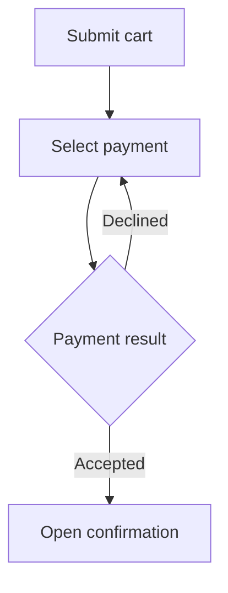
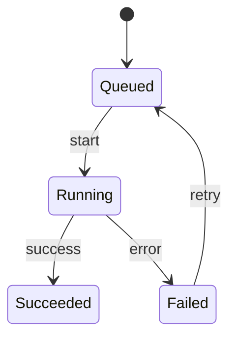

# Visual Explanation Decisions

## Prompt

Use `$vp-clear-writing` to answer each case independently from the supplied
facts. Do not install tools, publish content, or investigate a real system.

1. Explain checkout: the user submits a cart; a declined payment returns to
   payment selection; an accepted payment opens confirmation. No diagram was
   explicitly requested. The destination renders Mermaid flowcharts.
2. Explain a job's lifecycle: queued goes to running on start; running goes to
   succeeded on success or failed on error; failed returns to queued on retry.
   No cancellation behavior has been specified.
3. Explain a purchase workflow: a requester submits; a manager approves or
   returns it; finance pays after approval. Compare that explanation with one
   focused on asynchronous messages between the app and payment provider.
4. Give a decision tree for choosing offline export versus an interactive view.
   Export is required for print; interaction helps explore changing assumptions.
   Both can be needed. No numerical size threshold is supplied.
5. Rewrite one code comment or a text-only one-sentence status message.
6. A GitHub README needs a small architecture diagram; compare a team handoff
   that explicitly requires an editable draw.io file.
7. A formal workflow requires BPMN XML interchange. Someone proposes a Mermaid
   flowchart because both contain arrows.
8. A graph contains many edges and cannot be read in one view. An exported diagram
   contains Chinese labels and must be understood without relying on color.
9. A workflow detail is unknown. The destination cannot render diagrams and no
   image export tool is available. Write the useful explanation now.
10. Present measured latency samples versus a proposed interface. Neither a
    chart nor a generated screenshot establishes that the interface was tested.
11. Compare three deployment options across offline use, native format, and
    verification status. One capability is unknown, not unsupported.
12. Explain a five-step manual installation procedure, and contrast a matrix of
    overlapping eligibility rules whose policy says every matching rule applies.
13. Explain an algorithm that retains the first item for each id, preserves input
    order, returns a new list, and leaves the input unchanged. Include an empty
    input and repeated ids. The audience does not need runnable source code.
14. A user needs copyable TypeScript for an exact library API. Contrast a design
    note with an unspecified retry limit and asynchronous completion behavior.

## Expected Behavior

| Case | Expected decision |
| --- | --- |
| 1 | Proactively draw the user flow, including decline/recovery and confirmation; explain it briefly. |
| 2 | Use a state diagram or transition view with the four established states/events; do not invent cancellation. |
| 3 | Use owner groups/lanes for work handoffs, and sequence view for message timing. Keep actions and responsibility distinct. |
| 4 | Show conditions and allow both outputs; do not invent an exclusive choice or numeric cutoff. |
| 5 | Preserve the focused edit and explicit format; omit a decorative diagram. |
| 6 | Use host-compatible Mermaid for the README; honor native draw.io source plus export for the handoff. Do not install Pele to change GitHub. |
| 7 | Select BPMN-compatible tooling; a generic flowchart does not establish formal interchange. |
| 8 | Split views, retain editable source, inspect rendered labels/fonts, and use text explanations/labels alongside colors. |
| 9 | Preserve the unknown and provide a compact text/table fallback; report that a rendered diagram is unavailable. |
| 10 | Use a data plot for samples and a real capture for interface evidence; label proposals and limits. |
| 11 | Use a consistent comparison table; mark unknown separately from unsupported and retain evidence limits. |
| 12 | Use numbered steps for the procedure, and an all-match decision table for eligibility. Do not silently make rules exclusive. |
| 13 | Use labeled text-fenced pseudocode; state ordering, duplicate policy, output, and mutation boundary; trace repeated ids and empty input. |
| 14 | Identify the version/API evidence needed for runnable TypeScript; do not invent it or investigate beyond this fixture's scope. Preserve unspecified retry/async rules in the design note. |

## Regression Coverage

Proactive visuals without a diagram request, user flow versus state/workflow/
sequence, nonexclusive decisions, focused text-only scope, destination/native
format contracts, BPMN semantics, accessible dense diagrams, missing facts/tools,
and measured versus proposed behavior.
Also covers comparison tables, sequential-list boundaries, all-match rule tables,
pseudocode versus runnable source, stable duplicate handling, empty inputs, and
unknown asynchronous behavior.

## Manual walkthrough: 2026-10-31 (Asia/Taipei)

The editing agent exercised the ten cases using the new guide. Representative
outputs for the first two cases are below. Case 3 selected owner groups and a
separate sequence view; case 4 allowed export and interaction together. Cases
5-10 selected the bounded outcomes in the table, preserving explicit format,
native handoff, formal notation, accessibility, unknowns, and evidence limits.
This is a manual decision walkthrough, not an independent agent trial or proof
of rendering in a host, accessibility conformance, or runtime behavior.

Case 1: "A declined payment returns the user to payment selection. Confirmation
opens only after acceptance."



Case 2: "A failed job can be queued again by retry. Cancellation is unspecified."



## Manual table/pseudocode walkthrough: 2026-10-31 (Asia/Taipei)

The editing agent exercised cases 11-14. Case 11 selected a comparison table
with an explicit Unknown cell; case 12 retained numbered installation steps and
an all-match rule table. Case 14 kept real API code separate from design notation
and left unspecified retry/completion behavior open. Case 13 produced:

Pseudocode: return the first item per id in input order, without changing input.

```text
output := new empty list
seenIds := new empty set
FOR EACH item IN input, in order
    IF item.id IS NOT IN seenIds
        ADD item.id TO seenIds
        APPEND item TO output
RETURN output
```

Manual trace: `[A1(id=a), B1(id=b), A2(id=a)]` returns `[A1, B1]`;
empty input returns an empty list. The output list is new; item objects are
retained, not deep-cloned. These are manual traces of an illustrative algorithm,
not executable tests or proof of a concrete implementation's equality semantics.
