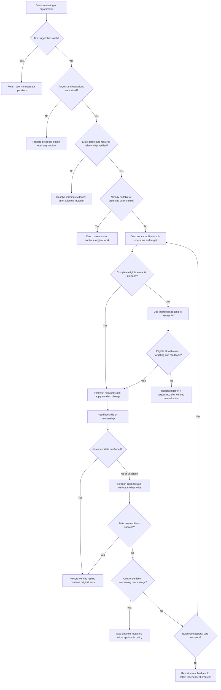

# Management Decision Tree

Use this tree for management mode. Apply it separately to each requested
operation; unsupported grouping does not block independently supported renaming.
The metadata procedure defines identity, evidence, concurrency, and readback.
Standing auto-naming policy can trigger this tree when discussion first resolves
the objective; the user need not explicitly ask to rename before implementation.

- Each route retains the original authorization and interface constraints. A
  denial at discovery also stops that affected action; it is not a missing API.
- An explicit request to replace a user-selected name can authorize a change;
  routine auto-management cannot. Unknown name ownership favors preservation.
- Readback must establish the intended session metadata, not a terminal title,
  generated summary, or task-progress label.
- Safe recovery needs new evidence or a known correction. A loop without either
  ends unresolved; it does not justify repeated writes or permission changes.
- For routine auto-management, avoid disruptive capability exploration. Continue
  the original task when no eligible low-cost route is currently available.
