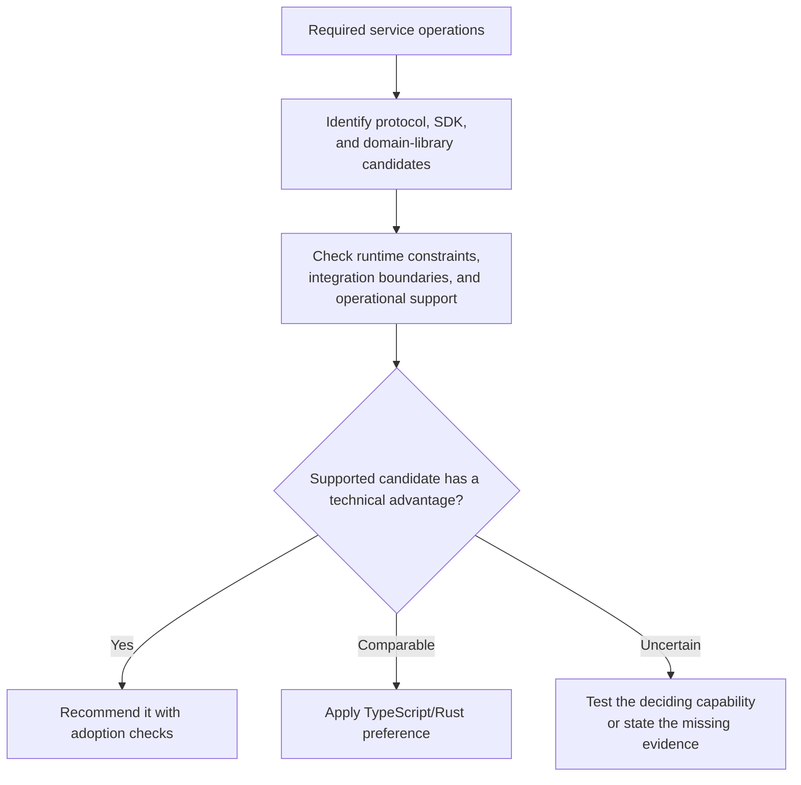

# Backend Services

Choose from the required protocols, SDKs, domain libraries, and operational
needs. A backend category alone does not select Go, TypeScript, or Rust.

| Need | Evidence to investigate |
| --- | --- |
| HTTP/RPC, jobs, proxies, agents | Go's standard library, concurrency, packaging, and diagnostics; equivalent support in other ecosystems |
| BFF or reusable JS product logic | Actual SDK and code reuse in TS; schema-generated clients may also provide shared API types |
| No GC or strict resource control | Compatible runtimes and domain libraries; Rust is a candidate, with end-to-end costs to verify |
| Fonts, scientific processing, JVM integrations | Direct use of domain libraries versus subprocess/service boundaries; the HTTP entry point need not own the processing |

For a webhook receiver, compare the actual database and queue clients, delivery
semantics, runtime budgets, and deployment. Go may fit well; JS or specialist
libraries may give another ecosystem an advantage. Language choice alone does
not resolve downstream database or network latency.

Read the chosen ecosystem reference for tooling. Adoption checks should cover
request behavior, concurrency limits, timeouts, cancellation, shutdown, and the
deployed artifact. Use representative load for performance claims.
