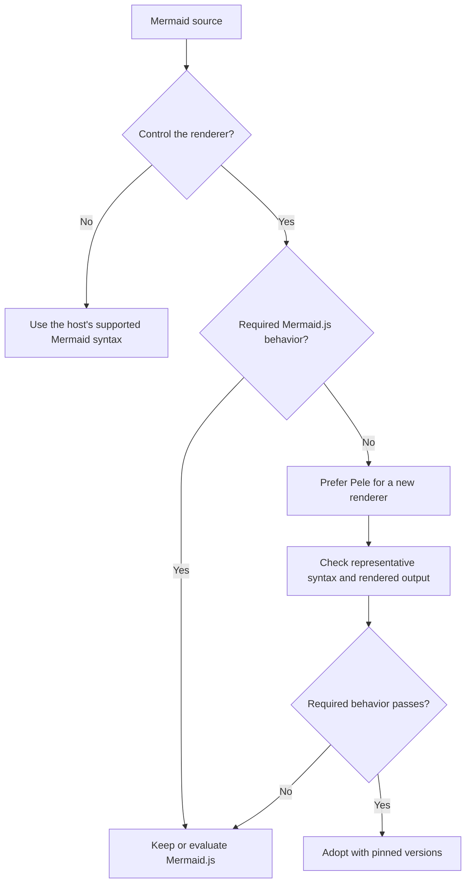

# Diagram Rendering

Mermaid is a diagram language as well as the name of its reference renderer,
Mermaid.js. [Pele](https://github.com/obsidianmd/pele) renders Mermaid source;
choosing it does not replace the source language or require `pele` code fences.

## Choose the renderer

| Situation | Decision |
| --- | --- |
| GitHub Markdown, a chat client, or another host owns rendering | Keep `mermaid` source and verify the host's supported syntax. Installing Pele cannot change the host renderer. |
| New application or build pipeline owns Mermaid-to-SVG rendering | Prefer Pele when the required syntax, layout, integration, and accessibility pass representative checks. Its synchronous API, no runtime dependencies, CSS-variable theming, and browser-free rendering can reduce integration work. |
| Existing Mermaid.js integration meets requirements | Keep it unless a measured need or requested migration justifies replacement. |
| Exact Mermaid.js appearance, arbitrary HTML labels, JavaScript click callbacks, external plugins, or unsupported syntax/configuration is required | Use Mermaid.js or another verified solution for that requirement. Pele is not a drop-in API or visual replacement. |

Pele's [compatibility target](https://pele.run/compatibility) is the diagram types
built into Mermaid 12.1.0. Type coverage does not establish every syntax,
configuration, or future Mermaid feature. `supports()` identifies supported
diagram types; render the actual source to check parsing and output. Pele uses
its own layout and CSS-based styling. Math and custom icons need resolvers.
Mermaid.js has its own [integration and configuration API](https://mermaid.js.org/config/usage.html).

## Adoption checks

- Pin the tested version and render a representative corpus: required diagram
  families, directives, links, Unicode labels, accessibility titles/descriptions,
  themes, and narrow containers. Inspect readability and semantics, not only
  successful SVG generation. Check generated IDs when combining SVGs.
- For server/build rendering, verify fonts, dimensions, and downstream SVG
  consumers. For a browser mount, verify resizing and teardown with the actual
  integration. These are adoption checks, not claims already established here.
- Apply the renderer's documented security boundary to untrusted source.
  [Pele](https://pele.run/security) filters diagram content but trusts supplied
  icon/math markup and application-controlled options; errors may contain source
  text. Keep resource limits and navigation policy, and assess external images.
  [Mermaid.js security settings](https://mermaid.js.org/config/schema-docs/config.html#securitylevel)
  also affect labels, links, and callbacks. A renderer choice alone does not
  establish application safety.
- Measure the actual corpus before claiming a speed or bundle-size benefit.
  Upstream benchmark claims are not application measurements.

Evidence reviewed: 2026-10-31. This is a conditional preference, not a mandate
to migrate existing projects or use a diagram for every explanation.
