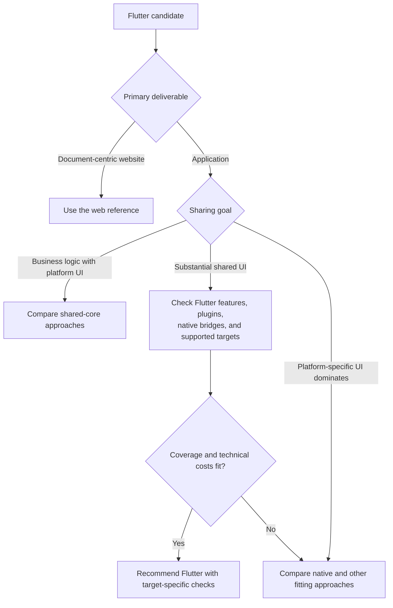

# Flutter and Dart

Evaluate Flutter for shared application UI and behavior across supported targets.
Flutter uses Dart; compare its plugin and rendering coverage with native apps,
React Native, and Compose Multiplatform.

[Flutter's architecture](https://docs.flutter.dev/resources/architectural-overview)
includes native controls and Kotlin/Swift integration. Assess bridge scope,
lifecycle, and plugin maintenance; a few native APIs need not rule it out.
For native components and sharing boundaries, compare
[React Native integration](https://reactnative.dev/docs/native-platform).

The [Flutter web FAQ](https://docs.flutter.dev/platform-integration/web/faq)
distinguishes application UI from document-centric sites. A separate web-native
content/docs site may fit better than reusing the app renderer.

## Tooling and adoption checks

Prefer mise for Flutter when a suitable backend supports the targets. Use the
Dart SDK bundled with that release; see the [SDK archive](https://docs.flutter.dev/install/archive).
Use pub for dependencies. Xcode and Android SDK readiness remain separate.
Choose routing and state packages for the app; no personal defaults are set here.

Plan analysis, widget/integration tests, release builds, and per-target device
checks. Include required deep links, permissions, resume/background behavior,
accessibility, and plugins. Success on one platform does not verify another.
