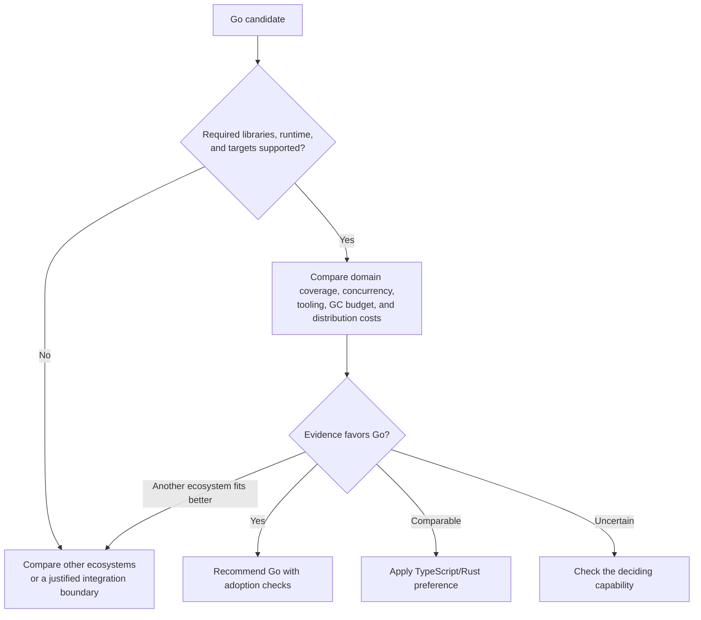

# Go

Consider Go for services, workers, infrastructure agents, and native CLIs when
its libraries, runtime, or distribution model fit the required operations.

## Benefits to compare

| Capability | Value and limit |
| --- | --- |
| [Native CLI distribution](https://go.dev/solutions/clis) | No separately installed JS runtime; verify cgo, dynamic libraries, runtime assets, and targets |
| [Runtime concurrency](https://go.dev/doc/effective_go#concurrency) | Goroutines fit independent requests/jobs; still need bounds, cancellation, and race checks |
| [HTTP standard library](https://pkg.go.dev/net/http) | Clients and servers may reduce external framework glue; check actual protocol and middleware needs |
| [Build/test tools](https://pkg.go.dev/cmd/go) and [diagnostics](https://go.dev/doc/diagnostics) | Integrated tests, benchmarks, fuzzing, profiling, and tracing; results depend on representative workloads |
| [Go 1 compatibility policy](https://go.dev/doc/go1compat) | Supports long-lived source maintenance, with exceptions; it does not guarantee third-party or binary ABI compatibility |

Compare Go's [GC costs](https://go.dev/doc/gc-guide) with the actual memory and
latency budget. If GC behavior is decisive, verify the runtime guarantees and
compare alternatives such as Rust. Native distribution alone does not distinguish Go from Rust.
These capabilities do not establish a general throughput or maintenance ranking.

## Tooling and adoption checks

Use Go modules and standard formatting, vetting, and tests. Prefer mise for the
initial toolchain where supported, and inspect `go.mod`/`GOTOOLCHAIN`:
[Go can select or download another toolchain](https://go.dev/doc/toolchain).
Align this behavior with version ownership and CI policy.

Execute release artifacts on supported targets. For services, check certificates,
configuration, concurrency limits, cancellation, signals, and shutdown. Use race
detection where supported and relevant; passing it does not prove race freedom.
