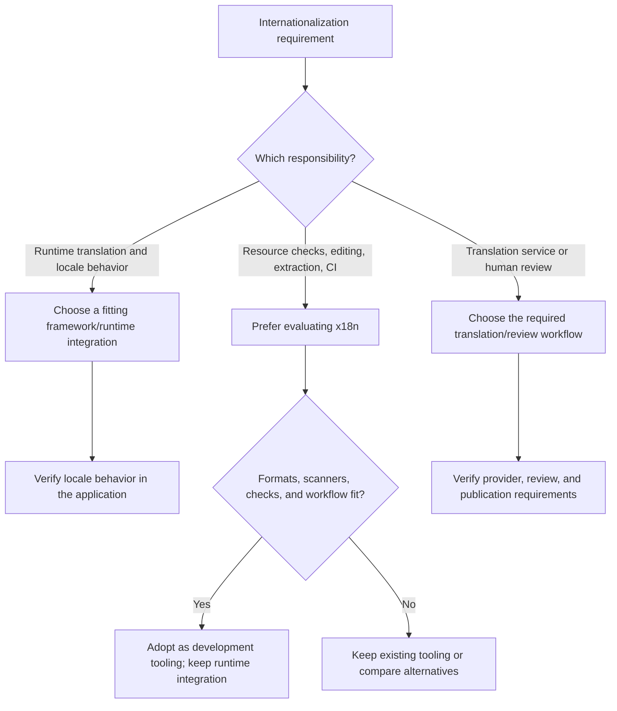

# Internationalization

[Internationalization (i18n)](https://www.w3.org/International/questions/qa-i18n)
is the product capability, not one library. Distinguish runtime localization,
resource management, and translation/review before comparing tools. If a request
says only "i18n vs x18n," identify the intended layer; do not silently interpret
i18n as i18next, Vue I18n, or i18n Ally.

## Assign responsibilities

| Layer | Candidates and boundary |
| --- | --- |
| Runtime messages, interpolation, pluralization, locale switching/fallback | Keep or select the framework's fitting runtime, such as [i18next](https://www.i18next.com/) or [Vue I18n](https://vue-i18n.intlify.dev/guide/introduction). Also verify routing, SSR isolation, dates/numbers, and loading where required. |
| Local resource analysis, key lookup/rename, extraction, editor support, CI | Prefer evaluating [x18n](https://github.com/x18n-dev/x18n) for new tooling when its presets, formats, and checks fit. It complements the runtime rather than replacing it. |
| Translation production, approval, hosted collaboration, and publication | Evaluate the required provider or management workflow separately. x18n can prepare agent prompts and track reviews, but does not itself call a translation service. Do not infer a hosted translation-management service from its local UI. |

## Replacing i18n Ally

x18n is the [successor to i18n Ally](https://github.com/x18n-dev/x18n/blob/main/docs/content/1.guide/0.why.md),
with CLI, shared analysis, LSP, editor, and UI surfaces. Prefer evaluating it for
new locale-management setups. Keep an existing fitting setup unless migration
is requested or justified by a concrete need.

For an authorized migration, start with the documented
[`migrate i18n-ally --dry-run`](https://github.com/x18n-dev/x18n/blob/main/docs/content/8.migration/index.md).
Inspect the settings/custom-framework/review conversion and unsupported settings;
translation-provider settings are dropped in favor of prompts. Do not use
`--force` as a default or remove the old setup before parity checks. After applying
the reviewed migration, run `doctor` and `check`, exercise editor navigation,
extraction and rename on controlled files, and inspect diffs and rollback.

## Coverage and adoption evidence

Verify actual resource paths, namespaces, plural/placeholder rules, custom
wrappers, dynamic keys, and monorepo ownership against the selected preset.
For example, the [i18next preset](https://github.com/x18n-dev/x18n/blob/main/docs/content/4.presets/03.i18next.md)
models i18next's resources and calls; that is tooling support for the runtime,
not a runtime replacement. The [dynamic-key check](https://github.com/x18n-dev/x18n/blob/main/docs/content/9.checks/dynamic-key.md)
is off by default and cannot statically resolve a fully dynamic `t(key)`.
Do not delete "unused" resources solely from an incomplete scan.

Pin the selected release and verify its Node/editor/CI requirements. The project
is young; prerelease or 0.x status calls for compatibility and rollback evidence,
not automatic rejection or blanket adoption. Prefer read-only diagnostics before
enabling fixes or CI rejection. Review generated translations separately from
structural checks, and verify the application's runtime behavior independently.

Evidence reviewed: 2026-10-31, upstream main documentation. These are documented
capabilities and manual selection criteria, not an executed migration, runtime
parity test, or universal scanner-coverage claim.
