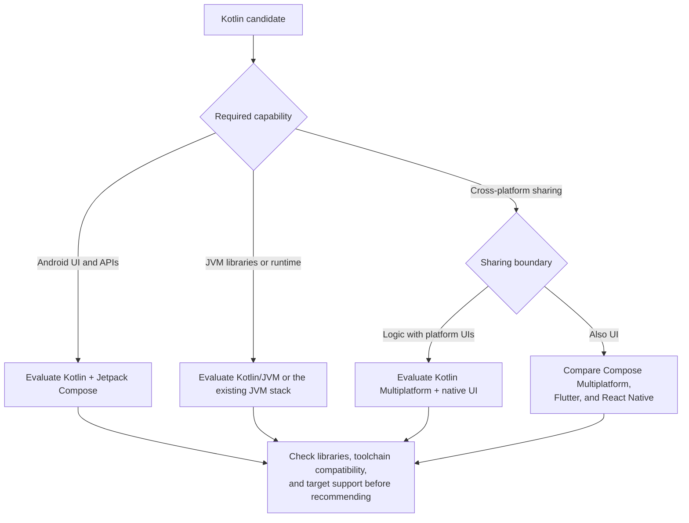

# Kotlin

Evaluate Kotlin for Android APIs, JVM integration, or shared code across targets.
Jetpack Compose is Android UI; Kotlin Multiplatform shares code, while Compose
Multiplatform can also share UI on supported targets.

Android's [Kotlin-first approach](https://developer.android.com/kotlin/first) and
[Compose tooling](https://developer.android.com/compose) support evaluating
native Android needs. Kotlin also supports
[JVM services](https://kotlinlang.org/docs/server-overview.html).

For shared logic with native UI, inspect the
[JetBrains template](https://kmp.jetbrains.com/templates/). Shared Kotlin does not
require shared UI; [platform-specific entry points](https://kotlinlang.org/docs/multiplatform/compose-multiplatform-entry-points.html)
still matter. Check APIs and libraries on each promised target.

## Tooling and adoption checks

Prefer mise for a compatible JDK. Keep Gradle owned by the
[Gradle Wrapper](https://docs.gradle.org/current/userguide/gradle_wrapper.html).
Align JDK, Gradle, Kotlin, Compose, and any Android Gradle plugin; a standalone
Kotlin CLI does not replace build-plugin configuration. Use supported SDK tooling.

Plan Android unit/instrumentation tests and relevant device/lifecycle checks,
multiplatform consumer/interoperability checks, or JVM deployment checks according
to the deliverable. Shared-module compilation alone does not verify a native app.
