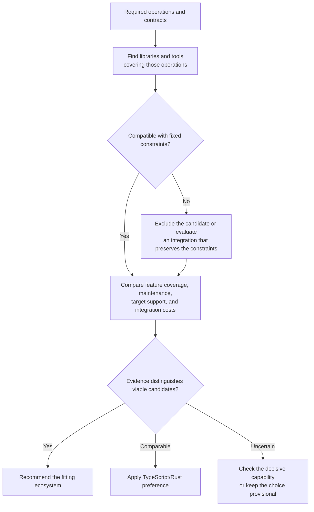

# Languages and Ecosystem Fit

Start with the operations the project needs. Find maintained libraries and tools
that implement them, then compare language and runtime costs. Other ecosystems
remain eligible even when absent from the examples below.

## Evidence to compare

Check the required functionality, supported formats and targets, maintained
releases, documentation, license, and integration path. For uncertain behavior,
exercise a representative input. Name the library or tool behind an ecosystem
advantage; package counts and language reputation are insufficient.

| Required capability | Candidates to investigate | Decisive checks |
| --- | --- | --- |
| Font inspection, subsetting, or variable-font operations | Python/fontTools and operation-specific alternatives | Format coverage, layout preservation, output validity, and execution environment |
| Browser UI or JS library consumption | TypeScript and relevant frameworks | Browser and package integration, required components, production rendering |
| Web SDK integration or shared product logic | TypeScript and equivalent supported SDKs | Actual reuse, feature coverage, runtime compatibility |
| Service, worker, proxy, or agent | Go, TS, Rust, and domain-specific ecosystems | Protocols, domain libraries, observability, deployment, resource budgets |
| Native CLI | Rust, Go, and fitting domain tools | Dependencies, target execution, runtime assets, distribution |
| Computational or systems core | Rust and suitable domain/native libraries | Algorithms, representative measurements, ABI or Wasm integration |
| Android platform UI and APIs | Kotlin/Compose and supported platform integrations | API coverage, lifecycle, background work |
| Apple platform UI and APIs | Swift/SwiftUI, UIKit, AppKit | Extensions, OS targets, native behavior |
| Shared cross-platform UI | Flutter/Dart, React Native, Compose Multiplatform | Target-specific features, plugins, rendering, native bridges |
| Shared logic with platform UIs | Kotlin Multiplatform or another shared core | Libraries on each target, interop, build and release coupling |
| JVM or scientific/ML integration | Kotlin/JVM, Python, or the fitting ecosystem | Supported libraries, workflows, deployment |

These are research leads. For example,
[fontTools](https://fonttools.readthedocs.io/en/latest/) supplies Python font
utilities, including [subsetting](https://fonttools.readthedocs.io/en/latest/subset/index.html).
Python may avoid reimplementing the required font semantics. A browser-only editor
or constrained native binary still needs a separate capability and distribution
comparison. Browser UI commonly fits TypeScript through its
[JavaScript integration](https://www.typescriptlang.org/docs/handbook/typescript-from-scratch.html).

## Integration boundaries

Compare a single-ecosystem solution with a shared core, subprocess, or service
only when the boundary offers a concrete benefit. Specify data or ABI contracts,
build order, failure handling, and release coupling. For apps, decide separately
whether to share UI, business logic, or both. Flutter is a framework using Dart;
SwiftUI and Compose are UI frameworks, not separate languages.
