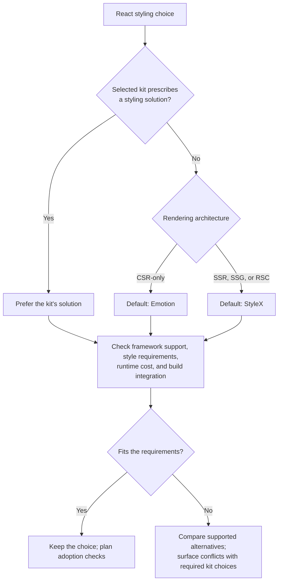

# React

Use the TypeScript and web references alongside this one. Honor the selected UI
kit before applying component or styling preferences.

## Components

| Need | Personal default |
| --- | --- |
| Styled Material-oriented product UI | [MUI](https://mui.com/material-ui/getting-started/) and its supported conventions |
| Custom visual identity and control of component styles | [Base UI](https://base-ui.com/react/overview/about) plus an independently chosen styling solution |

Select the needed component coverage and check licenses. A different kit may fit
better. Base UI is headless; it supplies neither CSS nor a mandatory engine.

## Styling

[MUI uses Emotion by default](https://mui.com/material-ui/integrations/styled-components/);
keep its supported integration even for SSR. [Base UI](https://base-ui.com/react/handbook/styling)
leaves styling open. When selecting independently, prefer Emotion for CSR-only
React and StyleX for SSR/SSG/RSC, subject to actual requirements and integration.

These are React-only preferences. [Emotion supports SSR](https://emotion.sh/docs/ssr),
[StyleX supports client React builds](https://stylexjs.com/docs/learn/installation/)
and [dynamic CSS values](https://stylexjs.com/docs/learn/styling-ui/defining-styles/#dynamic-styles),
and [React can use ordinary CSS](https://react.dev/learn#adding-styles).
Distinguish SSR, streaming, and RSC support for the selected framework/version.
A supported existing solution or lower runtime/build cost can override the default.

Adoption checks: state styling, portals, CSS ordering, themes, generated CSS,
hydration/server-component behavior, and Storybook when used.

For [StyleX with React/Vite](https://stylexjs.com/docs/learn/installation/vite/vite-react),
follow the version-matched plugin order and CSS-entry setup. Verify extracted
styles in a production build; development rendering alone does not prove extraction.

## Optional capabilities

- Prefer relevant TanStack packages for unmet needs: Query for remote data,
  Router when routing is not framework-owned, Table/Virtual for data display.
  Check adapters and maturity; keep one owner per router or remote cache.
- Use the web reference's state rules, including nanostores for suitable shared
  client state.
- Prefer [Storybook](https://storybook.js.org/docs/get-started/frameworks/react-vite)
  when components need isolated review or reuse. Verify its styling/providers
  and production build separately from the application.
- Prefer [React Compiler](https://react.dev/learn/react-compiler/installation)
  when supported. Check version-matched setup, plugin ordering, diagnostics, and
  important interactions; measure any claimed improvement.
- Use [React Doctor](https://github.com/millionco/react-doctor) as an additional
  diagnostic pass during implementation. Check its version, telemetry settings,
  and command effects. A scan does not authorize installing its agent skill or CI.
