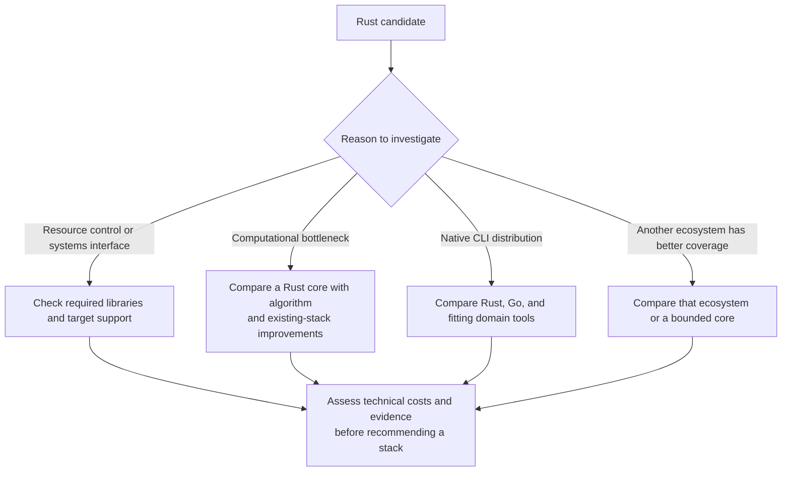

# Rust

Consider Rust for resource control, systems interfaces, native tools, or a
computational core supported by the required libraries. No specific async runtime
or web framework is a personal default here.

Use Cargo, rustfmt, and Clippy. Compare stable, beta, or nightly Rust when their
capabilities matter; apply the main release-channel decision rules and pin the
tested toolchain. Add an async runtime when needed. Use Cargo workspaces for
shared packages and build coordination; choose release tooling for the actual
distribution model.

Prefer mise where supported, but check its
[Rust/rustup integration](https://mise.jdx.dev/lang/rust.html): `RUSTUP_TOOLCHAIN`
can override `rust-toolchain.toml`. Keep version selectors aligned. A development
toolchain is separate from a library's promised minimum Rust version; declare and
check [`rust-version`](https://doc.rust-lang.org/cargo/reference/rust-version.html)
when making that promise.

For bindings or Wasm, specify the ABI/data contract and artifact distribution.
Adoption checks: formatting, Clippy, tests, package consumers, release execution
on promised targets, and representative performance measurements when relevant.
Cross-compilation alone does not establish target behavior.
