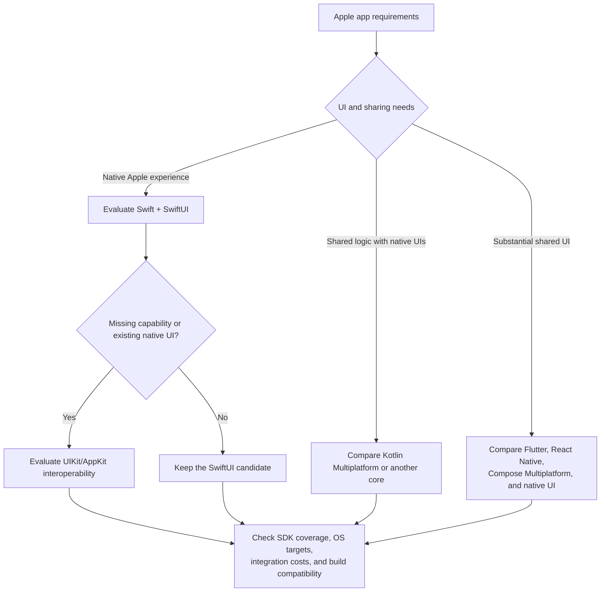

# Swift and Apple Platforms

Evaluate Swift for Apple SDKs, native UI, extensions, and platform integration.
This reference covers Apple apps; Swift itself is not limited to that use.

[SwiftUI](https://developer.apple.com/swiftui/) supports incremental adoption with
UIKit/AppKit. Check actual feature and OS coverage before choosing the boundary.
For multiple platforms, compare required native features and shared-code value;
platform count alone does not determine the UI approach.

## Tooling and adoption checks

Treat [Xcode](https://developer.apple.com/xcode/), Swift, platform SDKs, deployment
targets, and CI hosts as a coupled decision. Prefer mise for independent helpers;
a standalone Swift installation does not establish Apple app-build readiness.
Use Xcode/Swift Package Manager where appropriate.

Plan relevant unit/UI tests, release builds, and platform integration checks.
Distinguish simulator and physical-device results. Signing, archive/export, and
distribution evidence are separate from debug builds and require the applicable
authorization.
