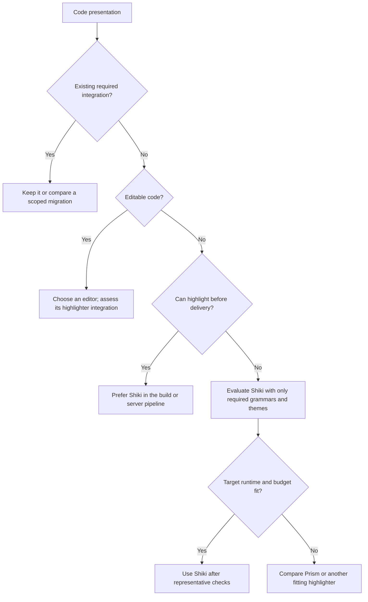

# Syntax Highlighting

Prefer [Shiki](https://shiki.style/guide/) for new code-display pipelines when
its language, runtime, output, and integration contracts fit. Preserve a fitting
existing highlighter. A highlighter does not supply editing, completion, or
language-server behavior.

## Compare the contracts

| Need | Selection guidance |
| --- | --- |
| Static documentation or server-rendered code | Prefer Shiki's TextMate grammars/themes and supported Markdown integration. Generate HTML before delivery where practical; no client highlighter is then needed. Prism can also run in Node, so build-time use alone does not distinguish the libraries. |
| Dynamic browser highlighting | Evaluate a fine-grained Shiki bundle and engine against actual startup, memory, and interaction budgets; compare Prism when a smaller required language set or simpler integration fits better. Do not compare Prism core alone with all Shiki languages. |
| Existing Prism hooks, plugins, custom grammar, or token-class CSS | Preserve [Prism's integration](https://prismjs.com/); Shiki output, themes, and transformers are not drop-in replacements. Check parity before a requested migration. |
| VS Code-style TextMate themes, dual themes, or Twoslash | Prefer evaluating Shiki's supported facilities. [Dual themes](https://shiki.style/guide/dual-themes) can switch through CSS variables without retokenization. |
| Editable source, selection, undo, completion, or large incremental documents | Choose an editor first; evaluate its integration, such as [Shiki with Monaco](https://shiki.style/packages/monaco). Syntax coloring alone does not meet editing requirements. |

## Engines, loading, and verification

[Shiki's engines](https://shiki.style/guide/regex-engines) include Oniguruma
(WASM) and JavaScript RegExp. Do not reject Shiki merely because WASM is
unavailable. Check the selected engine's grammar and target-runtime support;
custom grammars need their own check. Async initialization and synchronous
highlighting after loading are distinct; [fully synchronous core use](https://shiki.style/guide/sync-usage)
also exists with preloaded resources and an explicit compatible engine.

Follow [performance guidance](https://shiki.style/guide/best-performance): reuse
highlighters, load only needed resources, and consider workers for expensive
runtime work. Measure the shipped bundle and real snippets; neither library is
universally faster or more accurate. For Shiki 4, verify Node.js >= 20 per the
[migration notes](https://shiki.style/blog/v4). Check the selected version rather
than carrying this requirement into every future version.

Verify nested languages, malformed/partial snippets, unknown-language fallback,
escaping, copyable source, light/dark contrast, CSP compatibility, and the actual
Markdown/framework output. Trusted transformers/plugins and safe treatment of
surrounding user HTML remain application responsibilities. Plain escaped code is
a valid fallback when highlighting cannot load.

Evidence reviewed: 2026-10-31 (Shiki docs v4.5.0 and Prism v1 documentation).
[Prism's repository](https://github.com/PrismJS/prism#contribute-to-prism)
currently limits accepted PRs to security work while v2 is developed; recheck
maintenance and release-channel evidence before adoption. No performance or
application-integration benchmark was run for this selection guide.
