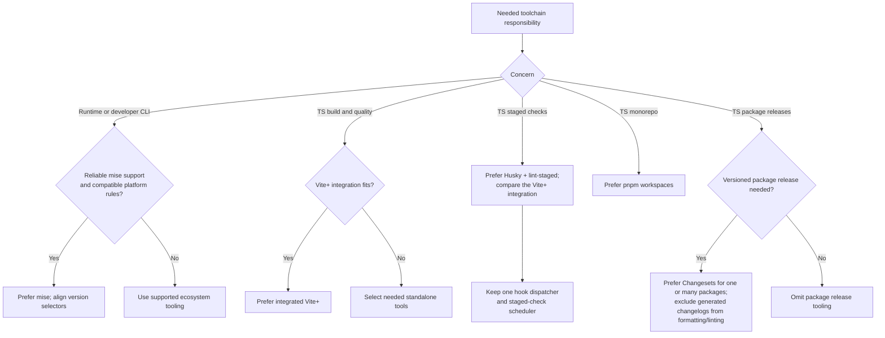

# Toolchain

Choose one owner for each runtime version, build function, hook, and release
operation. Add only responsibilities the project needs.

## Environments

Prefer [mise](https://mise.jdx.dev/dev-tools/) for runtimes and developer CLIs
when a maintained backend supports the target platforms and installation policy.
Use the ecosystem's package manager for project dependencies. Platform-coupled
SDKs and wrappers retain their supported version ownership; see the ecosystem
references before configuring them.

Resolve current stable compatible versions, then record the result in project
configuration and locks. Prefer the latest compatible stable TypeScript and a
supported Node.js version meeting build-tool requirements. Consumer runtime
support is a separate promise. Avoid floating `latest` in reproducible CI.

When mise owns Node.js/pnpm, align `packageManager` and CI with those versions.
[Vite+](https://www.viteplus.dev/guide) also manages environments; use its local
CLI without introducing a competing global version manager.

## Hooks

For TS projects needing staged checks, prefer [Husky](https://typicode.github.io/husky/)
plus [lint-staged](https://github.com/lint-staged/lint-staged).
[Vite+ hooks and staged checks](https://viteplus.dev/guide/commit-hooks) are an
integrated alternative. Preserve the preferred setup when supported; explain a
technical reason for replacing it. Avoid duplicate dispatchers and schedulers.
Keep hooks fast, preserve partially staged edits, and run full checks in CI.

## Workspaces and releases

Prefer [pnpm workspaces](https://pnpm.io/workspaces) for TS monorepos. Add task
orchestration only when execution dependencies or caching justify it.

Prefer [Changesets](https://github.com/changesets/changesets) for versioned
package releases, including a single published library. It manages versions and
changelogs, not workspaces. Private apps without package releases normally do not
need it. Use released documentation rather than development-branch assumptions.

Exclude generated `**/CHANGELOG.md` from formatter and applicable linter inputs,
including staged tasks. Check ignore behavior for explicitly passed files.
Keep authored `.changeset/*.md` entries checked unless repository policy differs.
