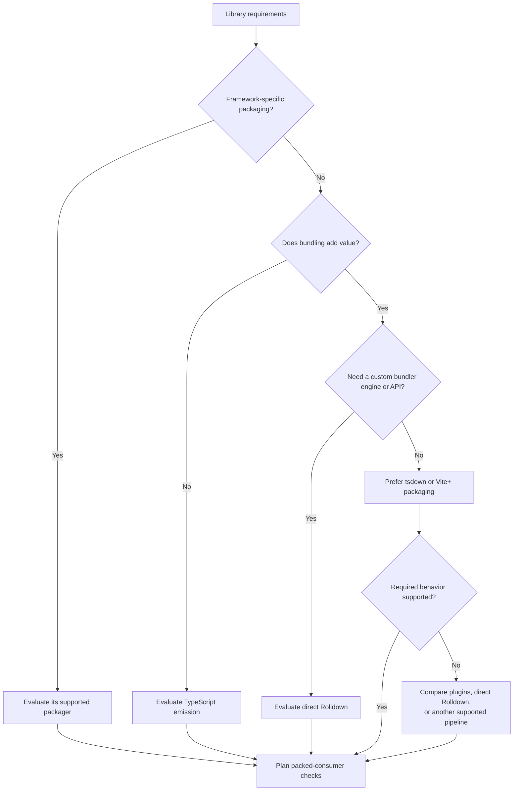

# TypeScript

Prefer pnpm, compatible TypeScript, strict type checking, and ESM for new code.
Evaluate stable and relevant prerelease/native compiler candidates under the
main decision rules; verify framework checkers, editor SDKs, compiler API
consumers, and incremental invalidation with the exact candidate version.
Keep required CommonJS consumers supported or plan an explicit
breaking change. Match module resolution and package exports to the host; see
[TypeScript modules](https://www.typescriptlang.org/docs/handbook/modules/reference.html).

## Build and quality tools

Prefer the VoidZero ecosystem where it fits:
[Vite+](https://www.viteplus.dev/guide) integrates Vite, Vitest, Oxlint, Oxfmt,
and Rolldown-based packaging. Prefer that integration when its versions and
framework support meet the requirements. Otherwise select the needed standalone
tools; a supported alternative can also win on lower technical cost.

Check framework plugins, lint-rule coverage, supported file types, formatting,
and type checking. Retain targeted framework tools where coverage is missing.
Bundling and declaration emission do not replace type checking, including
framework-aware checks for templates. Toolchain ownership belongs in the
[toolchain reference](toolchain.md).

If a linter offers compiler diagnostics, verify whole-project input coverage,
effective compiler options, missing references, and shared declaration changes
before replacing a compiler command. A successful lint run alone does not prove
build-mode equivalence. Compare a separate incremental compiler check with an
integrated check using measured reuse and diagnostic coverage; see
[TypeScript project verification](https://github.com/VdustR/skills/blob/main/skills/vp-typescript-best-practices/references/project-verification.md).

## Library packaging

[tsdown](https://tsdown.dev/guide/getting-started) provides library packaging on
Rolldown, including [declarations](https://tsdown.dev/options/dts).
[Rolldown](https://rolldown.rs/guide/getting-started) is the lower-level bundler;
direct use gives control while leaving packaging and type-output integration
to the project.

Choose by required behavior and maintenance cost; a small customization can fit
an existing tsdown hook, while an embedded bundling engine can justify direct
Rolldown. Distinguish build-tool Node.js requirements from consumer runtimes.

Adoption checks: install the packed artifact in a clean consumer and check ESM
imports, public subpaths, declarations, assets, externalized dependencies, and
promised runtimes or tree shaking. Test CommonJS only when it is a supported
contract. Component libraries also need their framework's packaging rules.
Check the library's effective tsconfig inputs and declaration settings, especially
when it shares a repository with an application. Record experimental compiler
integration separately from a successful build.

## Utilities

Prefer relevant TanStack packages when their adapters and capabilities improve
on the framework's existing facilities. Select individual packages as needed.
Prefer [es-toolkit](https://es-toolkit.dev/) for nontrivial utilities; use native
JavaScript for straightforward operations. Verify semantics before replacement.
