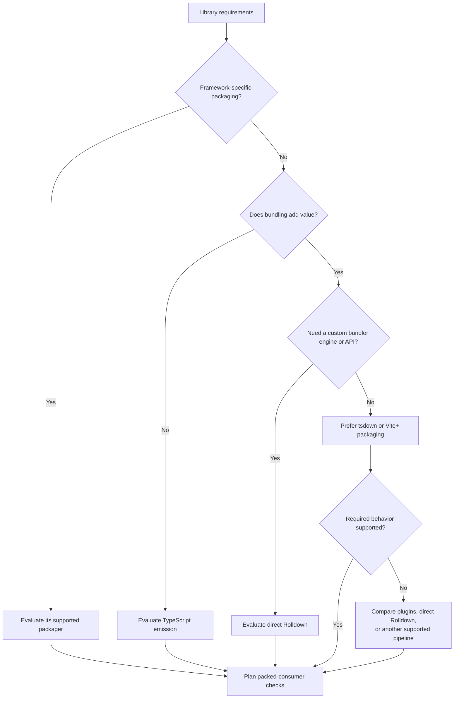

# TypeScript

Prefer pnpm, compatible TypeScript, and ESM for new code. Require
`@tsconfig/strictest` and application-owned `@total-typescript/ts-reset`, including
for lightweight scripts and `tsx`; running without a build does not waive the
checking setup. Follow the
[TypeScript setup workflow](https://github.com/VdustR/skills/blob/main/skills/vp-typescript-best-practices/references/setup.md)
for effective settings, environment isolation, coverage, and compatibility limits.
Evaluate stable and relevant prerelease/native compiler candidates under the
main decision rules; verify framework checkers, editor SDKs, compiler API
consumers, and incremental invalidation with the exact candidate version.
Keep required CommonJS consumers supported or plan an explicit
breaking change. Match module resolution and package exports to the host; see
[TypeScript modules](https://www.typescriptlang.org/docs/handbook/modules/reference.html).

## TypeScript over JavaScript

Use TypeScript for newly authored application code, Node.js utilities, build and
release automation, tests, and Electron main/preload code. Choose execution
separately from source language, using the script rules below or the actual
framework, host, and deployment contracts. Verify exact runtime/tool versions.
A small script or a preference for no build step alone is not a JavaScript
exception.

Source language and shipped format are separate decisions. Required `.js`,
`.mjs`, or `.cjs` output does not by itself require JavaScript source. Select
`.ts`, `.mts`, or `.cts` and the output strategy to match the verified module
contract rather than treating ESM as a reason to author `.mjs`.

Allow JavaScript when explicitly requested or when a verified host/tool contract
or concrete technical cost justifies it. State the reason and keep the exception
local, such as a config file whose loader requires JavaScript. Preserve vendored
or generated upstream JavaScript, and keep local fixes in existing JavaScript
projects scoped; this default does not authorize a repository-wide migration.

## Node.js script execution

Default lightweight Node.js scripts to native execution (`node scripts/task.ts`)
when the supported runtime has stable type stripping and the code uses erasable
TypeScript. Check the exact host rather than assuming the latest locally installed
Node.js also runs CI, packaged Electron code, or deployments. Use `.mts` for an
explicit ESM script outside a package; otherwise set the package module contract.
Use explicit relative source extensions and `import type` for type-only imports.
Native execution ignores tsconfig and does not type-check, transform JSX, or
resolve TypeScript `paths`; see [Node.js TypeScript support](https://nodejs.org/api/typescript.html).

Use [`tsx`](https://tsx.hirok.io/) when required code needs JSX, tsconfig path
resolution, or a verified transform/interop capability missing from the native
path. Size, a watch loop, or the label "advanced" alone does not require a runner.
Retain erasable syntax for new code; if an existing contract requires non-erasable
syntax, document the bounded compiler-setting exception and verify the runner.
Do not assume every compiler feature works: decorator metadata may require the
framework compiler or TypeScript emission. Keep supported existing runners unless
the task justifies migration; do not add ts-node or another runtime without a
specific requirement.

Both native execution and tsx require a separately checked project. For example,
an ESM Node script project can use this `tsconfig.scripts.json`, with `lib`, Node
types, and compatible versions selected for its actual runtime:

```json
{
  "extends": "@tsconfig/strictest/tsconfig.json",
  "compilerOptions": {
    "target": "ESNext",
    "lib": ["ESNext"],
    "module": "NodeNext",
    "types": ["node"],
    "noEmit": true,
    "allowImportingTsExtensions": true,
    "erasableSyntaxOnly": true,
    "verbatimModuleSyntax": true
  },
  "include": ["scripts/**/*.ts", "scripts/**/*.mts", "scripts/**/*.cts", "reset.d.ts"]
}
```

Create an application-owned `reset.d.ts` containing only:

```ts
import "@total-typescript/ts-reset";
```

Include that declaration in every intended checking project and run
`tsc -p tsconfig.scripts.json --noEmit` in verification/CI. Adjust inputs to cover
the actual scripts, tests, and configs; inspect inherited options rather than
substituting `strict: true`. Treat parsed JSON as `unknown` and validate it.
Do not import the reset from executable source: it changes types, not runtime
behavior. If a compatibility limit prevents the required setup, report it instead
of silently dropping strictest or ts-reset.

This execution default does not determine publication. Node does not strip TS
inside `node_modules`; publish JS and declarations for ordinary npm consumers.
Keep application resets out of public declarations and verify library consumers
without the reset. For services and packaged applications, choose native execution
or emitted artifacts from the deployment contract and framework requirements.

## Build and quality tools

Prefer the VoidZero ecosystem where it fits:
[Vite+](https://www.viteplus.dev/guide) integrates Vite, Vitest, Oxlint, Oxfmt,
and Rolldown-based packaging. Prefer that integration when its versions and
framework support meet the requirements. Otherwise select the needed standalone
tools; a supported alternative can also win on lower technical cost.

Check framework plugins, lint-rule coverage, supported file types, formatting,
and type checking. Retain targeted framework tools where coverage is missing.
Bundling and declaration emission do not replace type checking, including
framework-aware checks for templates. Toolchain ownership belongs in the
[toolchain reference](toolchain.md).

If a linter offers compiler diagnostics, verify whole-project input coverage,
effective compiler options, missing references, and shared declaration changes
before replacing a compiler command. A successful lint run alone does not prove
build-mode equivalence. Compare a separate incremental compiler check with an
integrated check using measured reuse and diagnostic coverage; see
[TypeScript project verification](https://github.com/VdustR/skills/blob/main/skills/vp-typescript-best-practices/references/project-verification.md).

## Library packaging

[tsdown](https://tsdown.dev/guide/getting-started) provides library packaging on
Rolldown, including [declarations](https://tsdown.dev/options/dts).
[Rolldown](https://rolldown.rs/guide/getting-started) is the lower-level bundler;
direct use gives control while leaving packaging and type-output integration
to the project.



Choose by required behavior and maintenance cost; a small customization can fit
an existing tsdown hook, while an embedded bundling engine can justify direct
Rolldown. Distinguish build-tool Node.js requirements from consumer runtimes.

Adoption checks: install the packed artifact in a clean consumer and check ESM
imports, public subpaths, declarations, assets, externalized dependencies, and
promised runtimes or tree shaking. Test CommonJS only when it is a supported
contract. Component libraries also need their framework's packaging rules.
Check the library's effective tsconfig inputs and declaration settings, especially
when it shares a repository with an application. Record experimental compiler
integration separately from a successful build.

## Utilities and common needs

Prefer an established library over hand-written code for a common need, after
checking that the repository does not already own one for that need:

- Remote data and its cache: [TanStack Query](https://tanstack.com/query/latest).
  Prefer other TanStack packages when their adapters and capabilities improve
  on the framework's existing facilities; select individual packages as needed.
- Typed API contracts between a TypeScript server and client:
  [oRPC](https://orpc.dev/), which serves one router over RPC and OpenAPI
  without code generation. Verify its adapter for the target framework and
  runtime.
- Runtime validation and schema-derived types: [zod](https://zod.dev/). Use
  the repository's existing schema library when it has one.
- Nontrivial utilities: [es-toolkit](https://es-toolkit.dev/). Use native
  language APIs for straightforward operations.

These are library choices, not an exception to the TypeScript source default.
Verify semantics before replacing existing code, and follow the dependency
installation rules that apply to the repository.
