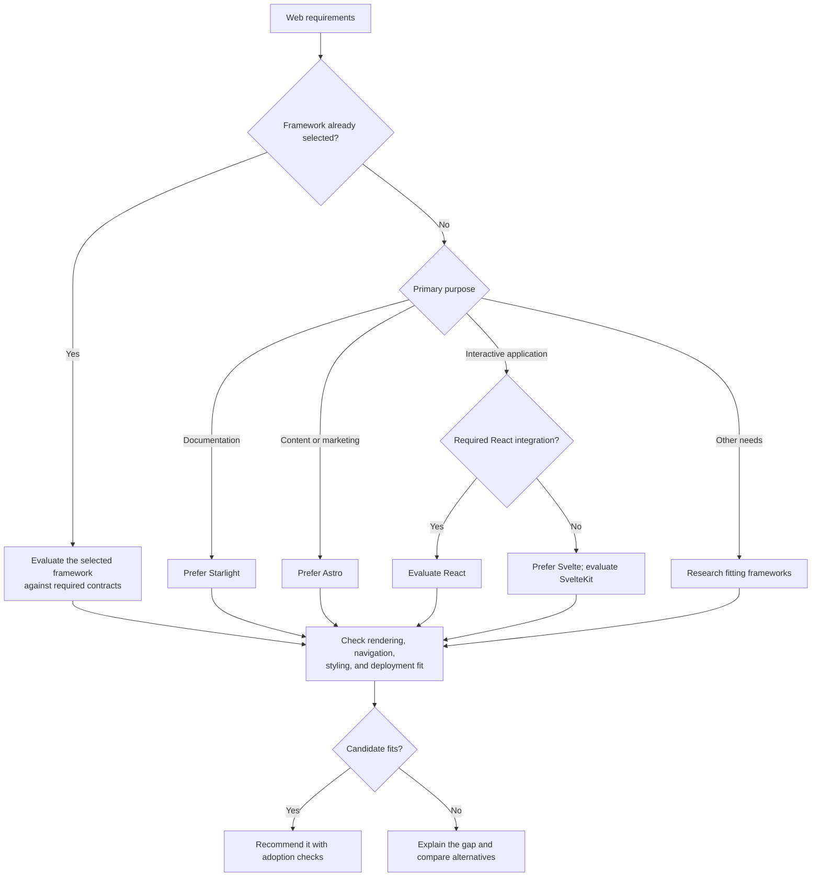

# Web Applications

Honor a selected framework first. When choosing one, compare content delivery,
interaction, routing, and rendering needs with these personal defaults.

- [Astro](https://docs.astro.build/en/concepts/why-astro/) suits content-first
  delivery with interactive areas added as needed.
- [Starlight](https://starlight.astro.build/) supplies Astro documentation features.
- [SvelteKit](https://svelte.dev/docs/kit/introduction) supplies application routing
  and rendering infrastructure around Svelte. Select its adapter and
  [rendering options](https://svelte.dev/docs/kit/page-options) explicitly.
- [Base UI](https://base-ui.com/react/overview/about) and MUI are React components.
  A product UI does not by itself require React; check the actual dependencies.

SPA/MPA navigation, CSR/SSR, and prerendering are separate decisions. Adoption
checks should cover direct links, reloads, history, production hosting, and
hydration where used. Server-rendered HTML alone does not establish MPA navigation.

## Content tooling

Read only the relevant selection guide:

- [Diagram rendering](diagrams.md) for an owned Mermaid-to-SVG pipeline versus
  host-controlled Markdown rendering.
- [Syntax highlighting](syntax-highlighting.md) for Shiki/Prism and the boundary
  between displaying code and providing an editor.
- [Internationalization](internationalization.md) for runtime localization versus
  x18n resource management and i18n Ally migration.

## Styling

| Situation | Default approach |
| --- | --- |
| Selected UI kit supplies supported styling | Follow its theme and styling integration |
| Vue SFC without such a kit constraint | Use scoped CSS or CSS Modules; [Vue also supports dynamic CSS values](https://vuejs.org/api/sfc-css-features.html) |
| Svelte without such a kit constraint | Use [scoped component styles](https://svelte.dev/docs/svelte/scoped-styles) and [global styles](https://svelte.dev/docs/svelte/global-styles) as needed |
| React without a kit styling constraint | Use the [React reference](react.md) |
| Another framework | Evaluate its native styling facilities |

Vue/Svelte normally need no extra CSS-in-JS engine for CSR or SSR. Add styling
tools for a concrete benefit, not to copy React defaults. Tokens, themes, global
CSS, and overrides remain relevant with built-in scoping. Intentional mixed
frameworks need explicit hydration and state-sharing boundaries.

## State ownership

| State | Preferred owner |
| --- | --- |
| Component-local UI | Framework-local state |
| Shared client or cross-island state | [nanostores](https://github.com/nanostores/nanostores), when native state does not already fit |
| Remote cache and mutations | A suitable data layer, such as [TanStack Query's supported adapter](https://tanstack.com/query/latest/docs/framework/svelte/overview) |
| Navigation or form state | The router/URL or form owner |

Check each package's framework support. Avoid duplicate remote caches. For SSR,
verify request isolation and hydration; per-user data must not leak through a
shared server singleton.
